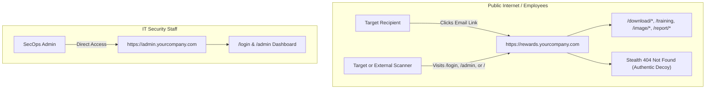

# 🚀 PhishGuard - Complete Production Server Deployment Guide

This guide walks you through deploying **PhishGuard** on an Ubuntu/Debian Linux server with **Nginx**, **PHP 8.2-FPM**, and **MySQL**, utilizing a dual-subdomain architecture for complete separation between the **Admin Console** and the **Target Phishing Link**.

---

## 🏗️ Architecture Overview



---

## 📋 Server Requirements

- **Operating System**: Ubuntu 22.04 LTS / 24.04 LTS or Debian 12
- **Web Server**: Nginx
- **PHP Version**: PHP 8.1 or PHP 8.2 (with FPM)
- **Database**: MySQL 8.0+ or MariaDB 10.6+
- **Required PHP Extensions**: `php-fpm`, `php-mysql`, `php-curl`, `php-mbstring`, `php-xml`, `php-intl`, `php-zip`

---

## Step 1: DNS Setup

Before starting on the server, configure two DNS `A` records in your domain registrar / Cloudflare pointing to your server's public IP:

| Type | Host / Name | Value / Destination | Purpose |
|---|---|---|---|
| `A` | `admin` (e.g. `admin.yourcompany.com`) | `YOUR_SERVER_PUBLIC_IP` | Restricted Admin Portal |
| `A` | `rewards` (e.g. `rewards.yourcompany.com`) | `YOUR_SERVER_PUBLIC_IP` | Decoy Phishing Link for Users |

---

## Step 2: Install Required Packages

SSH into your server and install Nginx, PHP, MySQL, and Certbot:

```bash
sudo apt update && sudo apt upgrade -y

# Install Nginx, MySQL, and Certbot
sudo apt install -y nginx mysql-server certbot python3-certbot-nginx git unzip

# Install PHP 8.2 and required modules
sudo apt install -y php8.2 php8.2-fpm php8.2-mysql php8.2-curl php8.2-mbstring php8.2-xml php8.2-intl php8.2-zip
```

Verify services are running:
```bash
sudo systemctl status nginx
sudo systemctl status php8.2-fpm
sudo systemctl status mysql
```

---

## Step 3: Configure MySQL Database

1. Open the MySQL console:
```bash
sudo mysql
```

2. Create the database and dedicated user:
```sql
CREATE DATABASE phishing_simulation CHARACTER SET utf8mb4 COLLATE utf8mb4_unicode_ci;

CREATE USER 'phish_user'@'localhost' IDENTIFIED BY 'StrongSecretPassword123!';
GRANT ALL PRIVILEGES ON phishing_simulation.* TO 'phish_user'@'localhost';
FLUSH PRIVILEGES;
EXIT;
```

---

## Step 4: Deploy Project Code

1. Create the web root directory:
```bash
sudo mkdir -p /var/www/phishing-simulation
```

2. Copy or upload your project files to `/var/www/phishing-simulation`:
```bash
# Example if cloning via Git:
# sudo git clone <your-repo-url> /var/www/phishing-simulation
```

3. Import the database schema and default templates:
```bash
cd /var/www/phishing-simulation
sudo mysql -u phish_user -p phishing_simulation < database.sql
```
*(Enter `StrongSecretPassword123!` when prompted)*

4. Set proper permissions for the web server (`www-data`):
```bash
sudo chown -R www-data:www-data /var/www/phishing-simulation
sudo chmod -R 755 /var/www/phishing-simulation

# Grant write access to cache, logs, sessions, and uploads
sudo chmod -R 775 /var/www/phishing-simulation/writable
```

---

## Step 5: Configure Application Environment (`.env`)

1. Copy `.env.example` to `.env`:
```bash
cd /var/www/phishing-simulation
cp .env.example .env
```

2. Edit `.env` with your editor:
```bash
nano .env
```

3. Update the following lines:
```ini
CI_ENVIRONMENT = production

app.baseURL = 'http://admin.yourcompany.com/'

database.default.hostname = localhost
database.default.database = phishing_simulation
database.default.username = phish_user
database.default.password = StrongSecretPassword123!
database.default.DBDriver = MySQLi
database.default.port = 3306

logger.threshold = 4
```

Save and exit (`Ctrl+O`, `Enter`, `Ctrl+X`).

---

## Step 6: Configure Nginx for Dual Subdomains

1. Copy the included `nginx.conf` to Nginx's configuration directory:
```bash
sudo cp /var/www/phishing-simulation/nginx.conf /etc/nginx/sites-available/phishguard.conf
```

2. Edit the configuration file to put your actual domain names:
```bash
sudo nano /etc/nginx/sites-available/phishguard.conf
```
*Replace `admin.yourcompany.com` and `rewards.yourcompany.com` with your real subdomains.*

3. Enable the site and disable the default site:
```bash
sudo ln -s /etc/nginx/sites-available/phishguard.conf /etc/nginx/sites-enabled/
sudo rm -f /etc/nginx/sites-enabled/default
```

4. Test Nginx syntax and reload:
```bash
sudo nginx -t
sudo systemctl reload nginx
```

---

## Step 7: Enable Free HTTPS (SSL) with Let's Encrypt

Run Certbot to automatically configure SSL certificates for both subdomains:

```bash
sudo certbot --nginx -d admin.yourcompany.com -d rewards.yourcompany.com
```

Select automatic redirect to HTTPS when prompted. Certbot will automatically update the Nginx configuration with TLS certs and set up automatic renewal cron jobs.

---

## Step 8: Initial Login & Setup

1. Open your browser and navigate to your admin portal:
   `https://admin.yourcompany.com/login`

2. Log in using default administrator credentials:
   - **Username**: `admin`
   - **Password**: `password123` *(Be sure to change this immediately in **Admin Users**)*

3. Go to **Settings** (`https://admin.yourcompany.com/admin/settings`):
   - **SMTP / Brevo Settings**: Enter your Gmail App Password or Brevo API Key to enable email delivery.
   - **Sender Display Name**: `Ravindranath Yarlagadda`
   - **Sender Email**: Your corporate or campaign sending address.

---

## Step 9: Verification & Testing

Verify that your security boundaries are working as expected:

| Test | URL | Expected Result |
|---|---|---|
| **Admin Portal** | `https://admin.yourcompany.com/login` | ✅ Displays PhishGuard Admin Login |
| **Phish Decoy Root** | `https://rewards.yourcompany.com/` | 🛡️ Returns **404 Not Found** (Stealth Decoy) |
| **Phish Decoy Admin** | `https://rewards.yourcompany.com/admin` | 🛡️ Returns **404 Not Found** (Cloaked) |
| **Phish Decoy Login** | `https://rewards.yourcompany.com/login` | 🛡️ Returns **404 Not Found** (Cloaked) |
| **Simulation Endpoint**| `https://rewards.yourcompany.com/training` | ✅ Displays Microsoft Forms awareness simulation |

---

## 🔒 Optional Extra Security Hardening

To restrict the Admin Portal so that **only your office IP address or corporate VPN** can access it, uncomment the IP restriction block in `/etc/nginx/sites-available/phishguard.conf`:

```nginx
# Under server_name admin.yourcompany.com;
allow 203.0.113.50; # Your office static public IP
allow 10.8.0.0/24;  # Your VPN subnet
deny all;
```
Reload Nginx:
```bash
sudo systemctl reload nginx
```
Even if someone discovers the admin subdomain, they will be blocked at the network perimeter.

