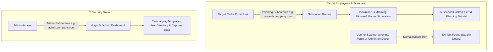

# 🛡️ PhishCall - Enterprise Phishing Simulation & Awareness Platform

**PhishCall** is a full-featured, open-source phishing simulation and employee cybersecurity awareness platform built on CodeIgniter 4, designed for IT Security teams, CISOs, and ethical penetration testers. Inspired by platforms like **Gophish** and **KnowBe4**, PhishCall enables organizations to run targeted phishing campaigns, track recipient interactions in real time, and deliver immediate educational debriefs to train employees against modern social engineering attacks.

---

## 🌟 Key Features

* **🌐 Dual-Domain & Subdomain Architecture (Gophish Style)**
  * **Admin Domain** (e.g. `admin.company.com`): Restricted exclusively to security staff for managing campaigns, viewing analytics, and editing templates.
  * **Phishing Domain** (e.g. `rewards.company.com`): Decoy public domain embedded in emails, tracking pixels, and landing pages.
  * **Strict Domain Cloaking**: Any employee or security scanner attempting to visit `/`, `/login`, or `/admin` on the phishing domain receives an authentic **HTTP 404 Not Found** decoy error, completely concealing the admin portal.

* **🎯 Multi-Campaign Management & Funnels**
  * Run simultaneous, independent phishing assessments without statistical cross-contamination.
  * Real-time funnel tracking: **Sent ➔ Opened ➔ Clicked ➔ Submitted Data ➔ Reported to Security**.
  * Dynamic timeline activity stream logging every event with IP address, timestamp, and user-agent.

* **📋 Realistic Microsoft Forms Simulation & 5-Second Hacked Alert**
  * High-fidelity simulation landing page styled after **Microsoft Forms** requesting employee details.
  * **5.5-Second Red Alert Scare**: Upon form submission, users experience a blinking crimson alert displaying their submitted credentials in a telemetry terminal.
  * Smooth automatic transition to an educational **"THIS WAS A PHISHING TEST"** debrief explaining red flags and security takeaways.

* **👁️ Captured Form Data Telemetry**
  * Admins can inspect the exact data entered by targets (Full Name, Email, Employee ID, Employment Status, IP, Timestamp) directly in the Admin Dashboard, Targets table, and CSV exports.

* **🛡️ "Report Phishing" Vigilance Button**
  * Optional toggleable footer link in simulation emails: *"Suspicious email? Report this email to IT Security 🛡️"*.
  * Accurately tracks employee reporting rates as a positive security awareness metric. Disabled by default to preserve attack realism.

* **📥 Gophish-Compatible Target Management**
  * Import employee directories via standard Gophish CSV format (`First Name, Last Name, Email, Position`).
  * Persistent user directory allowing selective multi-user enrollment across campaigns with search filters.

* **⚡ Dual Email Dispatch Engine**
  * Direct SMTP support (Gmail TLS/SSL, Office 365, internal postfix relays).
  * Native **Brevo (Sendinblue) REST API v3** integration for high-deliverability enterprise dispatch.

* **🐳 Production Docker Ready**
  * Pre-configured container running **Nginx**, **PHP 8.2-FPM**, and **Supervisord** on lightweight Alpine Linux.
  * Built for single-command deployment on **AWS EC2** connecting to **AWS RDS MySQL**.

---

## 🏗️ Architecture



---

## 🚀 Quick Start (Docker Deployment)

The fastest way to deploy PhishCall in production or locally:

### 1. Clone & Configure Environment
```bash
git clone <repository-url> phishcall
cd phishcall

# Copy environment configuration
cp .env.example .env
nano .env
```

Set your database credentials and domain URLs in `.env`:
```ini
CI_ENVIRONMENT = production
app.baseURL = 'http://admin.yourcompany.com/'

# Database (Local MySQL or AWS RDS)
database.default.hostname = phishcall-db.cxxxxxxx.us-east-1.rds.amazonaws.com
database.default.database = phishing_simulation
database.default.username = admin
database.default.password = YourStrongPassword

# Domain Configuration
PHISH_SERVER_URL = 'http://rewards.yourcompany.com'
ADMIN_SERVER_URL = 'http://admin.yourcompany.com'
```

### 2. Import Database Schema
```bash
mysql -h <DB_HOST> -u <DB_USER> -p <DB_NAME> < database.sql
```

### 3. Launch Docker Container
```bash
docker compose up -d --build
```
The application is now running with Nginx and PHP 8.2-FPM on ports 80 and 443!

---

## 💻 Local Development (XAMPP / PHP CLI)

1. Clone or extract the repository to your local web root (e.g. `c:\xampp\htdocs\phishing-simulation`).
2. Start **Apache** and **MySQL** in XAMPP.
3. Import `database.sql` into MySQL using phpMyAdmin or command line:
   ```bash
   mysql -u root -p phishing_simulation < database.sql
   ```
4. Copy `.env.example` to `.env` and verify database settings.
5. Open your browser:
   * **Admin Login**: `http://localhost/phishing-simulation/login`
   * **Default Admin Credentials**: Username: `admin` | Password: `admin`
   * *(Note: It is strongly recommended to change this default password immediately after first login via **Admin Users** (`/admin/profile`)).*

---

## 📖 Deployment Documentation

For comprehensive step-by-step instructions on deploying to **AWS EC2**, **AWS RDS**, configuring **Nginx dual subdomains**, and setting up free **Let's Encrypt SSL certificates**, refer to:

👉 [**DEPLOYMENT.md**](DEPLOYMENT.md)

---

## 📁 Project Directory Structure

```text
phishing-simulation/
├── app/
│   ├── Config/              # App, Database, Filters, Routes configurations
│   ├── Controllers/         # Admin, Auth, Phish, Quiz controllers
│   ├── Filters/             # DomainCloakFilter (strict domain isolation)
│   ├── Models/              # Campaign, Target, Template, Log models
│   └── Views/               # Admin Dashboard, Campaigns, Templates, Training pages
├── assets/                  # CSS stylesheets (admin.css) and UI resources
├── docker/                  # Docker container Nginx and Supervisord configs
├── writable/                # Application logs, sessions, cache, uploads
├── database.sql             # Complete database schema and default templates
├── Dockerfile               # Production Alpine Nginx + PHP 8.2-FPM container
├── docker-compose.yml       # Docker Compose service definition
├── DEPLOYMENT.md            # AWS EC2 & RDS deployment guide
├── nginx.conf               # Standalone dual-subdomain Nginx configuration
└── .env.example             # Environment configuration template
```

---

## 🔒 Security & Ethical Use Notice

> [!IMPORTANT]
> **PhishCall is designed exclusively for authorized corporate security awareness training, internal risk assessments, and educational simulations.**
> 
> Unauthorized phishing, credential harvesting without explicit employee consent, or deployment against third parties is strictly prohibited and illegal under computer security and privacy laws (e.g. CFAA, GDPR, Information Technology Act). Always ensure proper authorization from organizational leadership before dispatching simulations.
